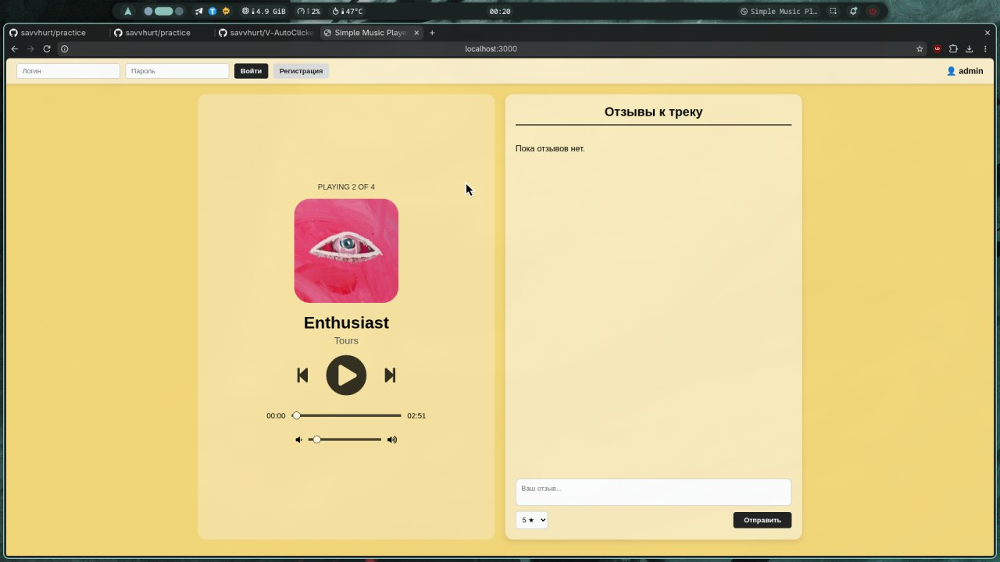

<div align="center">
  
# js-music-player
  
Небольшой легкий плеер использующий HTML, CSS, JAVASCRIPT, NODEJS и SQL.



</div>

## Запуск плеера

Сайт можно запустить через любой браузер, достаточно скачать последний [релиз](https://github.com/savvhurt/practice/releases/latest).

Как запустить сервер:
Нужно зайти в любой IDE и прописать в терминале:
```bash
npm run start
```
Дальше перейти в браузер и прописать в адресную строку:
```bash
localhost:3000
```

## Регистрация

Для регистрации нужно ввести данные вверху страницы (логин, пароль(не менее 6 символов)).

## Авторизация

Чтобы авторизироваться на сайте нужно пройти **РЕГИСТРАЦИЮ** и также ввести корректные данные в поля сверху.

## Отзывы

Для отправки отзывов на сервер нужно обязательно пройти **АВТОРИЗАЦИЮ** иначе сервер не даст отправить отзыв.
